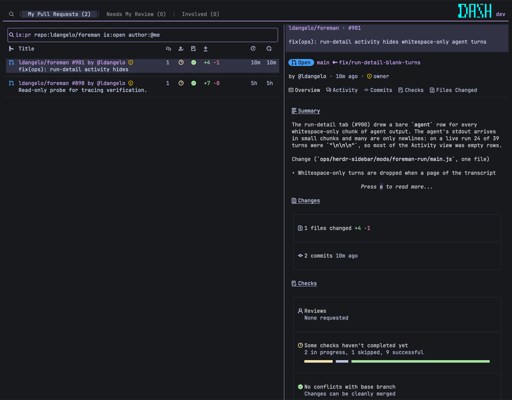

# herdr-dash

A [Herdr](https://herdr.dev) plugin (TUI) and mod (app): press one key and [gh-dash](https://github.com/dlvhdr/gh-dash) opens in a large dialog over your window, in the folder of the pane you were in. `q` quits it and closes the dialog.



## Install

### Herdr TUI (plugin)

```sh
herdr plugin install ldangelo/herdr-dash
```

Bind a key in `~/.config/herdr/config.toml`:

```toml
[[keys.command]]
key = "prefix+g"
type = "plugin_action"
command = "ldangelo.herdr-dash.open"
description = "gh-dash"
```

Or run **gh-dash: open popup** from the command palette. The popup is 90% of the terminal and starts in the folder of the focused pane; `q` quits gh-dash and closes it.

Needs `gh` with the extension (`gh extension install dlvhdr/gh-dash`) and `gh auth login`. macOS and Linux. Listed in the [Herdr marketplace](https://herdr.dev/plugins/) through the `herdr-plugin` topic.

### Herdr app (mod)

Ask your Herdr agent to add this repo, or by hand:

```sh
cp -R mods/gh-dash ~/.config/herdr-app/mods/
herdr-app check ~/.config/herdr-app/mods/gh-dash
```

Then add the binding from `keys.json` to the `global` section of `~/.config/herdr-app/keys.json` (default `cmd-shift-g`; pick another chord if you already use it). Editing `keys.json` makes the whole file yours: Herdr stops adding new default shortcuts to it.

Needs `gh` with the extension (`gh extension install dlvhdr/gh-dash`) and `gh auth login`.

## What it runs

One program: `gh dash`, started through your login shell (`hc run`), so that `PATH` and the extension resolve. The mod itself reads no files and makes no network calls; gh-dash talks to GitHub with your `gh` login.

## Behaviour

- Pressing the key again while gh-dash is open shows the same one instead of starting another (the terminal is named `popup-gh-dash`). This works for the local machine only.
- The terminal is removed when gh-dash exits.
- Tested on macOS with Herdr app: open, open twice, quit with `q`, `herdr-app check`. Not tested: the key chord itself (the command it runs was), and running on a remote machine.

## Other programs

Copy the folder under a new name, change the one `COMMAND` line in `main.js` (lazygit, k9s, btop, ...), and bind `mod.open:<new name>`. Each copy carries its own file because mods cannot import each other.

`RECIPE.md` is the brief another agent can rebuild this from.
