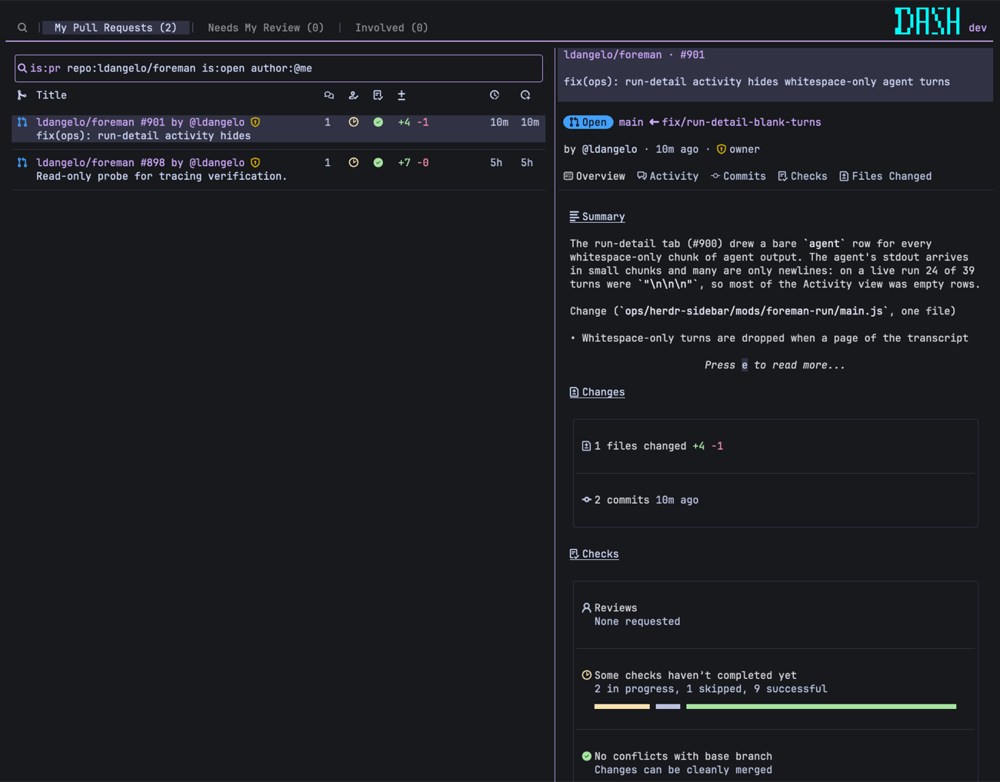

# GitHub dash popup

Press one key and gh-dash (the GitHub terminal dashboard) opens in a large dialog over whatever you are doing, already showing the repo of the pane you were in. Quit gh-dash with `q` and the dialog is gone.

## What you see

A modal dialog centered over the window, 90% of its width and height, dimming what is behind it. Inside it is a real terminal running `gh dash`: its tabs and PR list on the left, the selected PR's details on the right. Nothing else: no title bar, no buttons of Herdr's own.

## How it behaves

- The key (default `cmd-shift-g`, global) opens the mod `gh-dash`. It is a launcher with no UI of its own: a 2x2 px popup that starts the program, opens the dialog and closes itself in the same moment.
- The program starts in the focused terminal's folder, on that terminal's machine, so gh-dash picks up the repo you are in. With no focused terminal it starts in the core's default folder.
- Press the key again while gh-dash is up: the same terminal is shown again in a dialog. A second gh-dash is never started.
- Quit gh-dash with its own key (`q`). The terminal ends, is removed, and the dialog closes with it. `Esc` goes to gh-dash, not to Herdr, and a click beside the dialog does nothing (the dialog is modal).
- A failure to start (`gh` missing, `hc` error) is a Herdr notification titled "Couldn't open gh dash", and nothing is left open.

## Built from

- `mods/gh-dash/mod.json`: `{ "place": "none", "title": "GitHub dash", "overlay": { "kind": "popup", "width": 2, "height": 2 } }`.
- `mods/gh-dash/main.js`, default-exported `View` from `gpui-kit` that renders an empty `div()`. All the work is in `init`, inside `cx.spawn`, and it returns at once when `checking()` is true (`herdr-app check` renders every mod once and must not start a program).
- Constants: `COMMAND = "gh dash"`, and `TERMINAL_NAME` derived from it (`popup-gh-dash`: lowercase, runs of non-`[a-z0-9]` to `-`, trimmed, at most 32 characters, which is what `hc run --name` accepts).
- `herdr` functions: `focused()` (its `space` and `cwd`), `spaces()` (that space's `machine`), `hc(args)`, `openOverlay`, `closeOverlay`, `props()` (`overlay`, the launcher's own id), `notify`, `checking`.
- Programs run: `hc get popup-gh-dash` (is one already live?), then `hc run --bg --json --rm --no-parent [--on <machine>] --name popup-gh-dash [--cwd <folder>] -- /bin/sh -c 'exec "${SHELL:-/bin/sh}" -lic "$1"' sh "gh dash"`. The login shell is there so `PATH` and the `gh` extension resolve; it is the only program the mod starts. `--name` is passed only for the local machine.
- Opening: close the launcher overlay first, then `openOverlay({ kind: "dialog", modal: true, width: 0.9, height: 0.9, layout: { type: "block", content: { terminal: <address> } } })`. The address is the `address` field of the `hc run --json` output (or of `hc get`).
- Key: `keys.json` binds `mod.open:gh-dash` in `global`. Merge it into the person's file; ask before replacing a chord they already use.

## Watch out

- Close the launcher overlay before opening the dialog. Closing it afterwards hands the keyboard back to the pane underneath and gh-dash gets no keys.
- A dialog's layout closes itself when its terminal ends. That is the only way out: there is no close button, and `Esc` belongs to gh-dash.
- Reuse is by name and only checks the local core. On a remote machine a second key press starts a second gh-dash there.
- The remote-machine path (`--on`) was not run; no machine was available when this was written.
- Requires `gh` with the `dash` extension (`gh extension install dlvhdr/gh-dash`) and a `gh auth login`. gh-dash reads its own config from `~/.config/gh-dash/`.
- To use it for another program, copy the folder (`mod.clone` or by hand under a new name), change `COMMAND`, and bind `mod.open:<new name>`. Mods cannot import each other, so each copy carries its own file.

## Done when

- `herdr-app check ~/.config/herdr-app/mods/gh-dash` passes and starts no terminal.
- `herdr-app do mod.open '{"name":"gh-dash"}'` opens a dialog showing gh-dash; `hc ls` lists exactly one new terminal named `popup-gh-dash`.
- Running that command twice leaves one terminal and one dialog.
- Sending `q` (`hc keys popup-gh-dash q`) closes the dialog, and `hc ls` is back to what it was.
